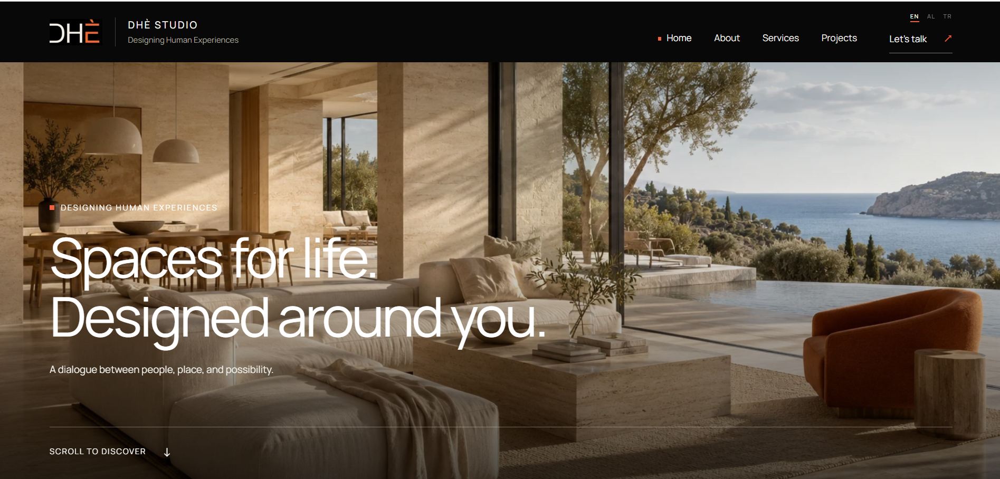
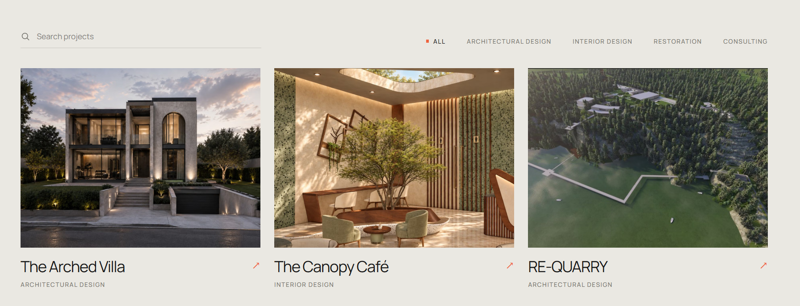
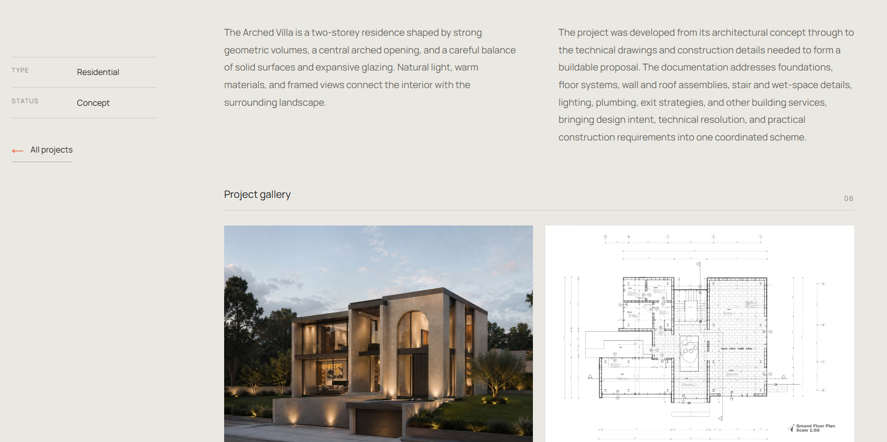
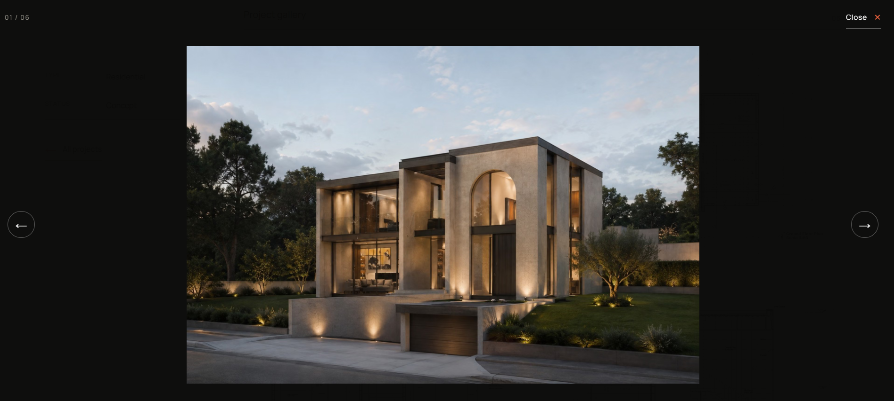
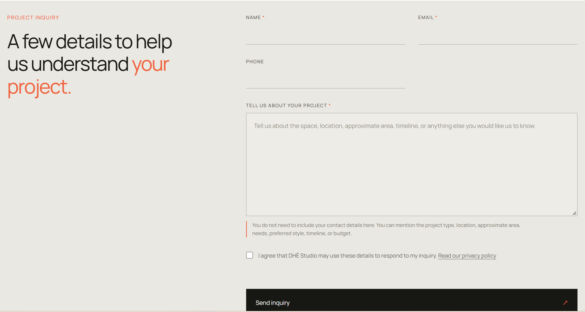
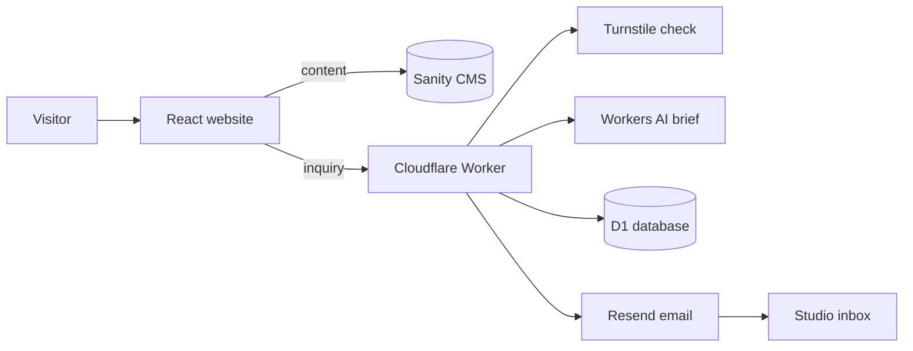

# DHÈ Studio

A multilingual portfolio and client-inquiry platform for **DHÈ Studio — Designing Human Experiences**, an architecture and interior design studio focused on how people experience the spaces around them.

**Live site:** [studiodhe.com](https://studiodhe.com)



| Projects with search and filter | Project page with gallery |
|---|---|
|  |  |

| Fullscreen gallery | Project inquiry form |
|---|---|
|  |  |

## At a glance

- **What it is:** a freelance client project. A complete platform where the studio manages its own projects and services, shows its work in three languages (English, Albanian, Turkish) and receives structured client inquiries.
- **My role:** design and full-stack development, from the CMS and the serverless backend to SEO, deployment, DNS and email setup.
- **Stack:** React 19, Vite, Sanity CMS, Cloudflare Workers, D1, Workers AI, Turnstile, Resend.
- **Quality (Lighthouse, production site):** Desktop 96 performance, 92 accessibility, 100 best practices, 100 SEO. Mobile 73 / 96 / 100 / 100 (mobile run on simulated slow 4G).
- **Built in about three weeks** (September 21 to October 12, 2026), with a clear Git history.

## Features

**Website**

- Responsive React site with an animated exterior-to-interior hero
- Home, About, Services, Projects, Project details, Contact, Privacy Policy and a custom 404
- Project pages with an image and video gallery, a keyboard-accessible lightbox and an optional hero video
- Project search and category filter
- Accessible navigation and semantic structure, with alt text required for every image

**Multilingual (English, Albanian, Turkish)**

- Each language has its own URL: `/about`, `/sq/about`, `/tr/about`
- The language comes from the URL, so every version can be linked, shared and indexed
- All content is editable in all three languages, with English as the fallback

**Content management**

- Sanity Studio for projects, services and the About page
- Localized fields for titles, descriptions and image alt text
- Sanity image pipeline for optimized, cropped images

**SEO**

- Per-page title, description, canonical URL and Open Graph tags, in each language
- `hreflang` links between language versions
- `sitemap.xml` and `robots.txt` generated at every build, including every project from Sanity
- Social preview image and favicon set

**Client inquiries**

- Contact form with validation and a consent link to the privacy policy
- Rate limiting and Cloudflare Turnstile spam protection
- Inquiries stored in D1 before any email is sent
- AI-structured project brief with a safe fallback
- Email notification to the studio through Resend
- 11 automated tests (Vitest) covering validation, spam protection, rate limiting, the AI fallback, email failures and what gets stored in the database

## How it works



**Inquiry flow**

1. A visitor completes the contact form and the Turnstile check.
2. React sends the inquiry to the Cloudflare Worker.
3. The Worker applies a rate limit (5 requests per minute per IP), validates every field and verifies the Turnstile token.
4. The project message and the interface language are sent to the AI model. The visitor's name, email and phone number are never sent to it.
5. The inquiry and the structured brief are saved in D1.
6. The Worker sends the email through Resend and records whether it was sent or failed.

## What the AI does, and what it doesn't

The AI feature does not design projects or give architectural advice. Its only job is to turn a client's natural message into an organized brief: project type, location, approximate area, timeline, budget, main priorities and the information that is still missing.

- Anything the client did not say stays clearly marked as "Not provided" instead of being invented.
- A person at the studio reads every inquiry, together with the client's original message.
- The client's name, email address and phone number are never sent to the model.
- If the AI step fails, the original message is used instead and the inquiry still goes through.

## Engineering decisions

- **The language lives in the URL.** An early version kept it in browser storage, which gave every language the same address. Moving it into the path makes each version indexable and shareable, and lets `hreflang` and the sitemap describe all of them.
- **Cheap checks run first.** Rate limit, then validation, then Turnstile, and only then the AI and the database. Abusive traffic never reaches the expensive steps.
- **Store first, email second.** The inquiry is saved before the email is attempted, with a status column (`pending`, `sent`, `failed`), so a delivery problem can never lose a client's message. An idempotency key makes retries safe.
- **The AI is a bounded helper, not a decision maker.** Its output is constrained by a JSON schema, validated field by field and cleaned. The visitor's message is treated as untrusted input. If anything fails, the original message is used instead. Everything placed in the email is escaped.
- **Generated, not hand-written, SEO files.** A build script reads the project slugs from Sanity and writes the sitemap and robots file, so a new project is never missing.
- **Content model built for editors.** Localized fields, required alt text in every language and one shared slug per project keep the editing simple and the URLs stable.
- **Tests mock the outside world.** The Worker tests replace Workers AI, the rate limiter, Turnstile and Resend, and check what is stored in a real test database.

## Development timeline

| Dates | What happened |
| --- | --- |
| Sep 21 – 23 | First version of the site, Sanity Studio and content schemas, frontend connected to the CMS, services and projects loaded from Sanity |
| Sep 24 | First client inquiry flow on a Cloudflare Worker |
| Sep 30 – Oct 3 | Multilingual CMS content, language selector and site translations, homepage interactions, redesigned projects and project details |
| Oct 4 – 6 | Inquiry backend hardened: validation, D1 storage, Turnstile, AI brief with tests, rate limiting, Resend email; video support and refined galleries |
| Oct 9 – 10 | Language-prefixed URLs, SEO component, privacy policy, sitemap and robots generation, favicon |
| Oct 11 – 12 | Production deployment on Cloudflare, real spam protection, domain connected |

## Production setup

Some of the work lives in service dashboards, not in this repository:

- **Hosting.** Cloudflare builds the site from GitHub on every push and serves it with single-page-app routing. The custom domains are declared in `wrangler.jsonc`.
- **DNS.** The domain's nameservers were moved to Cloudflare. The records for the studio mailbox and for email sending were carried over intact and kept as DNS-only.
- **Email.** The sending domain is verified in Resend with SPF and DKIM records. The Worker sends from an address on that domain.
- **Spam protection.** A Turnstile widget with a hostname allowlist. The site key is public, and the secret key is stored only in the Worker.
- **Secrets.** Stored as Worker secrets and build variables, never in the repository.
- **Allowed origins.** The production domain is listed in the Sanity CORS settings, the Worker and the Turnstile widget.
- **Search.** The site is registered in Google Search Console and the generated sitemap is submitted.

## Tech stack

| Area | Tools |
| --- | --- |
| Frontend | React 19, Vite, React Router, JavaScript, CSS |
| CMS | Sanity, GROQ, `@sanity/image-url`, `sanity-plugin-internationalized-array` |
| Backend | Cloudflare Workers, D1, Workers AI, Rate Limiting binding |
| Spam protection | Cloudflare Turnstile |
| Email | Resend |
| Hosting and DNS | Cloudflare |
| Testing and linting | Vitest with the Cloudflare Workers plugin, oxlint |

## Project structure

```
dhe-studio/
├── src/
│   ├── components/      # pages and shared components
│   ├── context/         # language context
│   ├── i18n/            # translations, privacy text, URL helpers
│   └── sanity/          # client, GROQ queries, image helper
├── public/              # favicon, social image, static assets
├── scripts/
│   └── generate-sitemap.mjs   # builds sitemap.xml and robots.txt
├── worker/              # Cloudflare Worker: inquiry API, tests, migrations
├── studio/              # Sanity Studio and content schemas
└── wrangler.jsonc       # website deployment settings
```

## Getting started

**Requirements:** Node.js 22 or newer.

```bash
npm install
npm run dev
```

```bash
npm run build     # generates the sitemap, then builds the site
npm run preview   # serves the production build locally
npm run lint
```

### Environment variables (website)

Create a `.env` file in the project root. These values become public once the site is built, so never put a secret in a `VITE_` variable.

| Name | Purpose |
| --- | --- |
| `VITE_SANITY_PROJECT_ID` | Sanity project |
| `VITE_SANITY_DATASET` | Sanity dataset |
| `VITE_SANITY_API_VERSION` | Sanity API version |
| `VITE_SITE_URL` | Public site address, used for canonical URLs and the sitemap |
| `VITE_API_URL` | Address of the inquiry Worker |
| `VITE_TURNSTILE_SITE_KEY` | Public Turnstile site key |

### The inquiry Worker

```bash
cd worker
npm install
npx wrangler dev          # run locally
npx vitest run            # run the tests
```

Local secrets go in `.dev.vars`, which is ignored by Git.

| Name | Type | Purpose |
| --- | --- | --- |
| `RESEND_API_KEY` | secret | Sends the inquiry email |
| `TURNSTILE_SECRET_KEY` | secret | Verifies the spam check |
| `INQUIRY_FROM_EMAIL` | secret or variable | Sender address on the verified domain |
| `INQUIRY_TO_EMAIL` | secret or variable | Studio inbox |
| `AI` | binding | Workers AI |
| `INQUIRY_RATE_LIMITER` | binding | Request rate limit |
| `dhe_studio_inquiries_db` | D1 binding | Inquiry storage |

**Deploying the Worker:** set the secrets with `npx wrangler secret put NAME`, create the table with `npx wrangler d1 migrations apply dhe-studio-inquiries-db --remote`, then run `npx wrangler deploy`.

## Roadmap

- Performance: serve the hero images in smaller, responsive sizes (they are the main reason mobile scores 73), preload fonts, and request Sanity images at display size
- Accessibility: fix the low-contrast language buttons and small touch targets in the navbar
- Security headers (HSTS, CSP, frame protection) through a Cloudflare headers file
- Admin dashboard for inquiries, with a retry button for failed emails
- Automatic retry of failed notification emails
- Cross-language semantic search across projects
- Privacy-friendly analytics
- Albanian and Turkish versions of the privacy policy
- CI with linting, tests and Lighthouse checks

## Credits

Designed and developed by ([@saralozi](https://github.com/saralozi)).

The DHÈ Studio name, logo, project images and written content belong to DHÈ Studio.